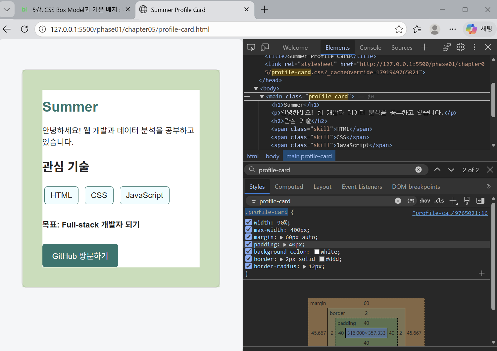

# Chapter 05 학습 기록

## 1. padding과 margin의 차이

- **padding**: 콘텐츠와 테두리 사이의 내부 여백
- **margin**: 요소 바깥쪽의 여백

`.profile-card`에서 padding을 24px에서 40px로 변경하여 카드 내부 공간이 넓어지는 것을 확인하였다.

## 2. content-box와 border-box의 차이

- `content-box`: 지정한 width에 padding과 border가 추가된다.
- `border-box`: 지정한 width에 padding과 border가 포함된다.

실무에서 전체 요소에 `box-sizing: border-box`를 적용하는 이유는 크기 계산을 쉽게 하기 위해서이다.

## 3. display에서 가장 헷갈렸던 부분

- `block`: 새로운 줄에서 시작하며 너비와 높이를 지정할 수 있다.
- `inline`: 글자처럼 같은 줄에 배치되며 일반적으로 너비와 높이 지정이 적용되지 않는다.
- `inline-block`: 같은 줄에 배치하면서 너비와 높이를 지정할 수 있다.

관심 기술 HTML, CSS, JavaScript를 `inline-block`으로 배치하였다.

## 4. LLM에게 질문한 내용

- padding과 margin의 차이
- content-box와 border-box의 계산 방식
- block, inline, inline-block의 차이
- DevTools를 이용한 Box Model 검증 방법

## 5. LLM 답변 중 직접 확인한 내용

- DevTools의 Elements → Styles에서 `.profile-card` 선택
- `padding: 40px` 적용 확인
- Box Model에서 padding, border, margin 확인
- 카드 내부 여백이 넓어진 화면 확인

### DevTools 검증 화면

## 6. 내가 직접 수정한 부분

- [x] `profile-card.html` 작성
- [x] `profile-card.css` 작성
- [x] 관심 기술 3개 표시
- [x] GitHub 버튼 형태 링크 구현
- [x] 카드 가로 가운데 정렬
- [x] DevTools에서 padding 40px 실험
- [x] 검증 화면 캡처

## 7. 실습 결과

CSS Box Model의 content, padding, border, margin이 요소의 공간에 영향을 주는 방식을 확인하였다.
특히 DevTools에서 padding 값을 직접 변경하면서 CSS를 수정하지 않고도 레이아웃 변화를 실험할 수 있음을 학습하였다.